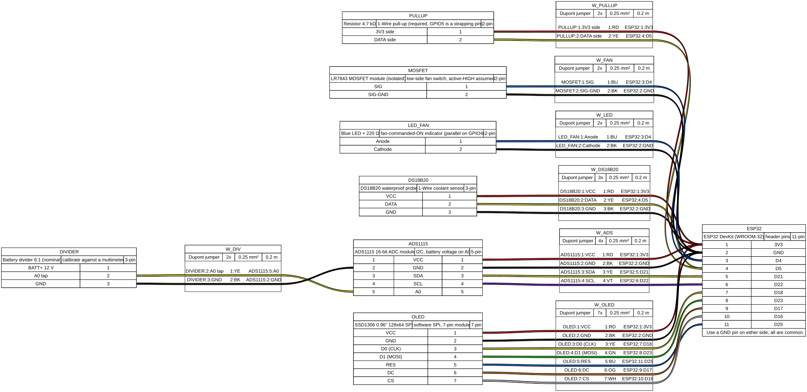

# esp32-moto-computer

ESP32 controller for the cooling fan of a Honda CRF250L, growing into a small onboard computer.

The stock bike only switches the fan on at about 98 °C. On slow technical riding that is late.
This controller switches it on earlier, at 88 °C, and off at 80 °C. It also counts engine hours
and shows status on a small OLED screen.

**Status: bench prototype.** The firmware is written and tested. Stages 1–2 of the bench
bring-up passed on real hardware on 2026-07-24 (temperature probe and screen). Next: the real
fan (stage 3), then fitting it on the bike. See [docs/BENCH_BRINGUP.md](docs/BENCH_BRINGUP.md).



## What it does

| Function | How |
|----------|-----|
| Fan control | DS18B20 probe on the coolant; fan ON at 88 °C, OFF at 80 °C (hysteresis) |
| Engine hours | Engine counts as running while system voltage is ≥ 13.2 V (charging), stopped at ≤ 12.8 V; total saved to flash |
| Battery voltage | ADS1115 16-bit ADC through a voltage divider |
| Display | SSD1306 128×64 OLED: temperature, fan state, voltage, engine hours |

## Safety design

The controller adds to the stock system; it never replaces it.

- **Wired in parallel with the stock thermoswitch.** If this controller fails or abstains, the
  stock switch still runs the fan at about 98 °C. The engine can't overheat because of it.
- **Untrusted readings are ignored.** The DS18B20 reports -127 °C when disconnected and exactly
  85 °C at power-on before its first conversion. 85 °C looks real and sits in the fan's range, so
  both are treated as faults. On a fault the controller abstains and the bike behaves as stock.
- **Fan off at boot** until a trusted reading arrives.

The reasoning behind each choice is in the decision log: [docs/DECISIONS.md](docs/DECISIONS.md).

## Hardware

ESP32 DevKit (WROOM-32), DS18B20 waterproof probe with a 4.7 kΩ pull-up, LR7843 MOSFET module
(low-side fan switch), ADS1115 ADC with a 6:1 divider, SSD1306 OLED on software SPI. Full bill of
materials: [docs/wiring.bom.tsv](docs/wiring.bom.tsv). An ESP32-S3 pin set is defined but untested.

## Build and test

[PlatformIO](https://platformio.org) project.

| Environment | Use |
|-------------|-----|
| `esp32dev` | Production thresholds (88/80 °C), for the bike |
| `esp32dev_bench` | Low thresholds (30/28 °C) to trigger the fan by warming the probe by hand |
| `ledtest` | Output check on GPIO4 only |
| `esp32-s3` | ESP32-S3 board (untested) |
| `native` | Unit tests on the host |

```sh
pio run -e esp32dev_bench -t upload   # flash the bench build
pio test -e native                    # unit tests: fan logic and engine hours
```

The decision logic lives in pure libraries (`lib/FanControl`, `lib/EngineHours`), so it is tested
on the host without hardware. It also runs in the [Wokwi](https://wokwi.com) simulator:
[docs/WOKWI.md](docs/WOKWI.md).

## Roadmap

1. Real fan relay, fitted on the bike, ride-tested
2. Air temperature, ride logging, service reminders from engine hours
3. Phone dashboard over Bluetooth LE

## License

MIT
